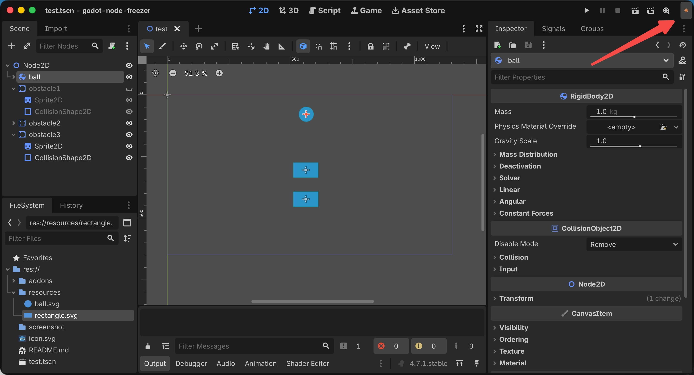
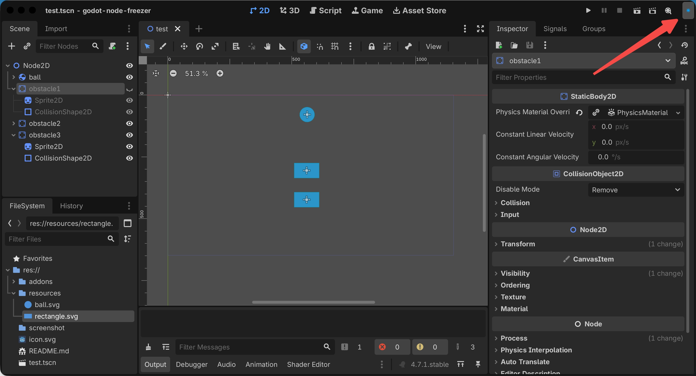

# Node Freezer

**Freeze / unfreeze any node with one click — stops scripts, rendering, physics, collisions, and audio\.**

Node Freezer is a Godot editor plugin that lets you instantly “freeze” or “unfreeze” any node in your scene, just like toggling visibility\. When frozen, the selected node itself completely stops working at runtime — scripts no longer execute, visuals are hidden, collisions are disabled, and audio pauses — while the node structure remains intact in the scene tree and can be unfrozen at any time\.

---

## ✨ Features

- **Editor toolbar button** — one\-click freeze/unfreeze with clear status icons\.

    - Unfrozen: warm orange sun ☀️

    - Frozen: bright cyan snowflake ❄️

- **Independent per\-node state** — freezing or unfreezing a node does **not** recurse into its children\. Each node’s frozen state is fully independent from its parent and siblings\.

- **Completely stops runtime logic for the selected node**:

    - Scripts: `process_mode` set to `DISABLED`, halting `_process`, `_physics_process`, `_input`, etc\.

    - Rendering: the node’s `visible` is set to `false`\.

    - Physics \& collisions: `CollisionObject2D` gets `disable_mode = REMOVE`, fully removed from the physics simulation\.

    - Audio: `AudioStreamPlayer` nodes are paused\.

- **Full undo/redo support** — every freeze/unfreeze action can be undone with `Ctrl + Z`\.

- **State persistence** — frozen state and original values are stored in node metadata and saved with the scene\.

- **Safe \& non\-destructive** — nodes are never removed from the scene tree; `owner` relationships, signal connections, and scene structure remain unchanged\.

---

## 📦 Installation

1. Open the **AssetLib** tab in the Godot editor, search for **Node Freezer**, and install\.

2. Or manually download the ZIP, extract it, and place the `addons/node_freezer` folder into your project root\.

3. Go to **Project → Project Settings → Plugins**, find **Node Freezer**, and enable it\.

4. A new icon button will appear in the top toolbar \(see below\)\.

---

## 🔍 Button Location

The plugin button is added to `CONTAINER_TOOLBAR`, which is the **main toolbar at the top of the Godot editor**\. It is typically located to the **right of the play/run buttons** and to the **left of the scene switcher dropdown**\.

Here is a reference layout of the Godot 4 editor:

```Plain Text
[Menu Bar: Scene  Project  Debug  Editor  Help]
[Main Toolbar: ◀ ▶ Scene Selector | 2D 3D Script Game | ▶️ ⏸️ ⏹️ | ... | 🎬 Run Current Scene | 🎯 Node Freezer Button | ...]
```

The button is a **square icon button**\. Its icon changes to indicate the current state of the selected node:

- **Warm orange sun** ☀️ → the node is **not frozen** \(click to freeze\)\.



- **Bright cyan snowflake** ❄️ → the node is **frozen** \(click to unfreeze\)\.



If you cannot see the button:

- Make sure the plugin is enabled in **Project → Project Settings → Plugins**\.

- Try restarting the Godot editor\.

- The toolbar may be crowded; look for a small icon button with a sun or snowflake symbol\.

---

## 🎮 Usage

1. **Select one or more nodes** in the Scene tree \(hold `Ctrl` for multi\-select\)\.

2. Click the **Node Freezer** button in the top toolbar:

    - If the button shows an **orange sun**, clicking it will **freeze** the selected nodes\.

    - If the button shows a **cyan snowflake**, clicking it will **unfreeze** the selected nodes\.

3. Frozen nodes stop completely at runtime; unfreezing restores their original state\.

4. Press `Ctrl + Z` to undo the last freeze/unfreeze action\.

**Note**: Freezing or unfreezing only affects the selected nodes themselves\. It does **not** propagate to their children\. You can freeze a child independently, then freeze its parent, and the child will keep its own frozen state when the parent is unfrozen\.

---

## ⚙️ Compatibility

- **Godot version**: Godot 4\.5 and above \(tested on Godot 4\.7\.1\)\.

- **Platform**: All platforms supported by the Godot editor\.

- **License**: MIT\.

---

## 📝 Notes

- Freezing does **not** remove the node from the scene tree\. The node remains visible, selectable, and saved\.

- If the node contains an `AudioStreamPlayer`, unfreezing resumes playback from the paused position, not from the beginning\.

- If the node itself uses a `@tool` script, its editor `_process` will also stop when frozen — this is expected behavior\.

- **Children and inheritance**: When you freeze a parent node, its children may temporarily stop working at runtime due to Godot’s built\-in `process_mode` inheritance and `visible` propagation\. However, the plugin does **not** modify the children’s own frozen state or original properties\. Unfreezing the parent restores the children to their previous state, and any child that was independently frozen remains frozen\.

---

## 🔗 Links

- Source code / Issue tracker: [https://github\.com/jasper\-xu/godot\-node\-freezer](https://github.com/jasper-xu/godot-node-freezer)

- License: [MIT](https://opensource.org/licenses/MIT)


